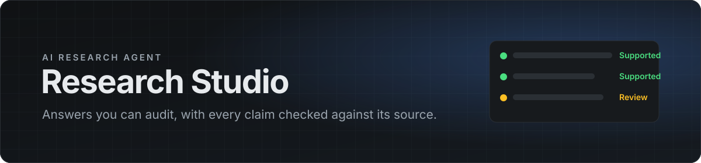
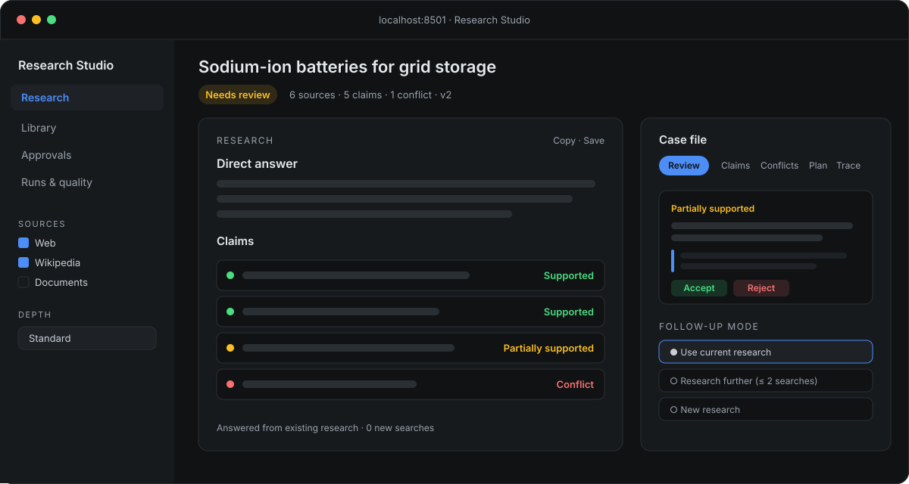
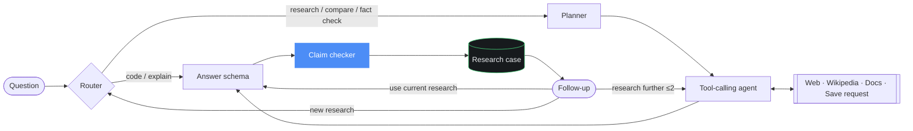

<p align="center">
  
</p>

<h1 align="center">Research Studio</h1>

<p align="center">
  <b>An AI research agent that turns a question into a case you can audit, with every claim checked word for word against its source.</b>
</p>

<p align="center">
  
  
  
  
  <a href="LICENSE"></a>
</p>

<p align="center">
  <a href="#quickstart">Quickstart</a> ·
  <a href="#core-workflow">Workflow</a> ·
  <a href="#architecture">Architecture</a> ·
  <a href="#evaluation">Evaluation</a> ·
  <a href="#roadmap">Roadmap</a>
</p>

<p align="center">
  
</p>

<!-- Swap the preview above for a real recording when you have one:
     
     and add a live link under it:
     [](https://your-app.streamlit.app) -->

---

## Why it is different

Chat assistants give you an answer. Research Studio gives you a **research case**: the plan, the claims, the evidence behind each one, the conflicts, your review decisions and a trace of every run.

|  | Chat assistants | **Research Studio** |
|---|:---:|:---:|
| Cites sources | ✓ | ✓ |
| Checks each claim's quote against the text actually retrieved | — | ✓ |
| Sends unsupported or conflicting claims to a review queue | — | ✓ |
| Follow-ups that reuse evidence instead of searching again | — | ✓ |
| Editable, versioned research plans | — | ✓ |
| Exports a full audit report | — | ✓ |

The goal isn't "100% accurate". It's that **every material claim is traceable to inspectable evidence, and unsupported claims are flagged.**

## Core workflow

```text
 Ask  →  Route  →  Plan  →  Research  →  Answer  →  Verify  →  Review  →  Export
         (type)   (opt.)    (tools)     (schema)   (claims)   (you)     (audit)
```

1. **Ask** a question in chat.
2. **Route.** The request is typed as code, explanation, research, comparison, fact check or clarification. Simple requests skip research entirely.
3. **Plan** *(optional).* Review, reorder and edit the agent's sub-questions before anything runs.
4. **Research.** The agent searches the web, Wikipedia and your documents within your source rules.
5. **Answer.** One structured answer card: direct answer, code, verdict or comparison table, plus sources.
6. **Verify.** Claims are extracted and each quote is checked word for word against the retrieved text.
7. **Review.** You accept or reject anything not fully supported.
8. **Follow up or export.** Ask more questions (reusing the evidence), or export the case as a Markdown audit report.

## Key features

- **Analyst workspace, not a chat feed:** each case opens with its title, status, a thin verdict bar and one line of counts. Answers sit beside an **evidence column** listing every source with its quote and the verdicts it backs.
- **Claims highlighted in the answer:** each sentence is coloured by its claim check (green supported, orange partial, red unsupported or conflicting, gray no evidence), so you can see what's verified at a glance.
- **Claim-level verification:** each claim is *Supported*, *Partially supported*, *Unsupported* or *Insufficient evidence*. A claim is downgraded if its quote can't be found in the retrieved text.
- **Conflicts:** passages that contradict each other are shown side by side.
- **Review queue:** the case shows *Needs review* until every flagged claim is accepted or rejected.
- **Intent routing:** keyword rules handle clear cases with no model call. Only ambiguous requests use one fast LLM call.
- **Token-efficient follow-ups:** *Use current research* never searches, *Research further* allows at most 2 new searches, and *New research* starts a new case.
- **Versioned plans:** each step records why the agent added it and whether you edited it. Each plan version is linked to the answer it produced.
- **Source rules:** allow and deny lists of domains, enforced in code on every search result.
- **Partial answers, not lost work:** if research hits its depth limit, the answer is written from what was already found and clearly marked *Partial*. Failed runs show what went wrong, what was kept, and a **Retry** button.
- **Research activity:** each answer has a collapsed list of the lookups it made, with ✓ / ✗ for each.
- **Case file:** six tabs: Review, Claims, Conflicts, Plan, Evidence and Trace.
- **Audit export:** a Markdown report with a claims table, conflicts, plan versions, lookups and the run trace.

## Architecture



| Component | Responsibility | Code |
|---|---|---|
| **Router** | Returns a `Route` (`response_type`, `context_mode`, `needs_tools`, reason). Keyword rules first, LLM fallback | `route_request` · `agent.py` |
| **Planner** | Structured sub-questions with a reason for each | `make_plan` · `agent.py` |
| **Agent** | LangChain tool-calling agent. Each run carries a `RunContext` (thread, depth, sources, rules, budget) | `agent.py` |
| **Tools** | Web search (a primary engine plus one fallback, with timeouts and caching), Wikipedia, documents, and an approval-gated save request | `tools.py` |
| **Checks** | Word-for-word quote matching, claim downgrades, answer cleaning and quality checks. Pure functions, fully unit-tested | `checks.py` |
| **Answer schema** | One Pydantic `Answer` envelope for every response type. If the reply isn't valid JSON, it is repaired once | `agent.py` |
| **Claim checker** | Splits the answer into up to 8 claims, then checks each quote in code | `check_claims` · `agent.py` |
| **Evidence store** | Keeps raw lookups for the audit trail, plus compact evidence items for follow-ups | `evidence.py` |
| **UI** | Sessions, answer card, case file, export, Runs & quality | `studio.py`, `app_pages/` |

Tool failures, such as a search timeout, come back to the agent as messages instead of exceptions, so it can try another source.

## Quickstart

```bash
git clone https://github.com/sidhantds/Research-Studio.git && cd Research-Studio
python -m venv venv && source venv/bin/activate   # Windows: venv\Scripts\activate
pip install -r requirements.txt
cp .env.example .env                              # then add GOOGLE_API_KEY
python -m streamlit run app.py
```

Open **http://localhost:8501**. You need Python 3.11+ and a Gemini API key from [Google AI Studio](https://aistudio.google.com/apikey).

**Terminal mode:** `python main.py` asks for a question and prints the `Answer` as JSON.

## Configuration

| What | Where |
|---|---|
| API key | `GOOGLE_API_KEY` in `.env` (or Streamlit secrets) |
| Gemini model · prompt version | `MODEL_NAME` · `PROMPT_VERSION` in `agent.py` |
| Routing keyword rules | `_RULES`, `_CODE_VERB`, `_CODE_NOUN`, `_FRESH` in `agent.py` |
| Search engines and timeouts | `_ENGINES`, `_ENGINE_TIMEOUT` in `tools.py` |
| Depth presets · "Research further" budget | `DEPTHS` · `FURTHER_MAX_LOOKUPS` in `studio.py` |
| Evidence items per follow-up | `PACK_ITEMS` in `evidence.py` |
| Source rules | **Settings** in the app |
| Theme | `.streamlit/config.toml` |

## Using the app

| Where | What you do there |
|---|---|
| **Sidebar** | Pick sources (Web, Wikipedia, uploaded PDF/TXT/Markdown) and depth (Quick, Standard, Deep) |
| **Settings** | Pick a research mode: *Review plan* or *Auto-research*. Also set source rules |
| **Research** | Chat, choose a follow-up mode above the chat bar, review claims in the case file, export |
| **Library** | Every research case with claim and review counts, plus saved files |
| **Approvals** | Approve or skip file-save requests from the agent |
| **Runs & quality** | Timing, tokens and quality checks for each run |

**Try these:**

| Prompt | What happens |
|---|---|
| `Generate hello world in Java` | **Code**: one call, no searches; filename, run commands, expected output |
| `Are sodium-ion batteries viable for grid storage?` | **Research**: claims checked, conflicts shown |
| `Is the Great Wall visible from space?` | **Fact check**: a verdict with quoted evidence |
| *(follow-up)* `Which one is cheaper?` | Answered from existing research: **0 new searches** |

## Evaluation

### Offline evals

```bash
python evals/run_evals.py          # no API key needed
python evals/run_evals.py --live   # also routes ambiguous requests with Gemini
```

| Eval | Cases | Result |
|---|---|---|
| **Routing by keyword rules** | 25 labeled requests | 72% decided with no model call, **100% accurate** on those (18/18) |
| **Quote checking** | 12 real, altered and invented quotes | 5/5 real quotes accepted, 7/7 fakes rejected, **0 false accepts** |

A false accept is the dangerous error: it would let an unsupported claim count as supported. The labeled cases are in [`evals/`](evals).

### Tests

```bash
pip install -r requirements-dev.txt
pytest
```

78 unit tests cover routing, quote matching, claim downgrades, citation renumbering, source rules, JSON repair, evidence compression, claim highlighting and session saving. They run offline in under a second.

### Live checks

Every run is also scored automatically on the **Runs & quality** page:

| Check | Passes when |
|---|---|
| **Valid format** | The reply parses into the `Answer` schema |
| **Sources grounded** | Each cited source was actually retrieved in this session |
| **Plan followed** | Every source a plan step required was actually used |
| **Claims supported** | The share of claims marked *Supported* after quotes are checked in code |
| **Follow-ups with no new search** | The share of follow-ups answered from evidence the session already had (higher means lower cost) |

Each run's trace records the timestamp, step, lookups, context size, tokens, model, prompt version and source rules. That lets you compare runs across prompt or model changes.

## Safety and permissions

- **Approval before writing:** the agent can only *request* a file save. Nothing is written until you approve it in **Approvals**.
- **Prompt-injection guard:** text from tools and evidence is passed to the model as reference material, never as instructions.
- **Quotes checked in code:** the model never grades its own citations unchecked. Quotes it invents are caught and the claim is downgraded.
- **Source rules enforced in code:** denied domains are filtered out of results, not just discouraged in the prompt.
- **Human in the loop:** flagged claims stay in review until you decide on them.
- **Sessions survive a refresh:** each browser session has a random id in the URL (`?sid=…`), and its cases are saved as JSON (never pickle, so loading a file can't run code) in `.sessions/`. Only 32-character hex ids are accepted, so a crafted URL can't read other files. Anyone with the URL can open that session, like an unlisted link.
- **Your key:** on a public deploy, every visitor uses your API key, so make the app private under **Settings → Sharing**.

## Project structure

```text
app.py            entry point: navigation, sidebar, settings
app_pages/        research · library · approvals · runs
studio.py         sessions, research runs, answer card, case file, export
agent.py          router, Answer schema, prompts, agent, planner, claim checker
checks.py         quote matching, claim downgrades, answer cleaning, quality checks
persistence.py    saves cases so a refresh keeps them
evidence.py       evidence items and compact follow-up context
tools.py          web search, Wikipedia, documents, source rules
main.py           CLI (read-only tools)
tests/            78 offline unit tests
evals/            labeled routing and quote cases + runner
assets/           README images
```

## Roadmap

- [x] Editable, versioned plans
- [x] Claim-level evidence with checked quotes
- [x] Conflict handling and review queue
- [x] Approval-gated file saves
- [x] Quality scorecard and run trace
- [x] Offline unit tests and an eval set
- [x] Partial answers and a clear failure card with Retry
- [ ] Split `studio.py` into UI and pipeline modules
- [ ] PDF export of the audit report
- [ ] Recency filtering based on real publication dates
- [ ] Edit a plan after it runs, re-run as v2 and compare answers
- [ ] "Blocked" plan steps and explained mid-run plan changes
- [ ] High-impact flag that always sends a claim to review
- [ ] Persistent cases (storage and sign-in)

The full history is in [CHANGELOG.md](CHANGELOG.md).

## Limitations

- Cases survive refreshes, but on Streamlit Community Cloud the saved files are wiped when the app restarts. Export the audit report to keep a case for good. There are no user accounts yet.
- There's no recency filter. It was removed because search engines only treat dates as a hint.
- The audit export is Markdown only for now.
- Claim checks add one model call per answer (code answers skip it).
- Verification makes claims *traceable*. It doesn't guarantee they're true.

<details>
<summary><b>Troubleshooting</b></summary>

- **`streamlit` blocked or not found (Windows):** use `python -m streamlit run app.py`.
- **`DLL load failed ... Application Control policy`:** Windows Smart App Control can block compiled packages such as pandas. The app avoids pandas, so it runs with the policy on.
- **Search keeps failing:** reorder or trim `_ENGINES` in `tools.py`. Wikipedia still works.
- **"No results from allowed sources":** your *Only use these domains* rule is too narrow.
- **"No `GOOGLE_API_KEY` found":** put `.env` in the project root and restart.

</details>

<details>
<summary><b>Deploy to Streamlit Community Cloud</b></summary>

1. Push to GitHub, open [share.streamlit.io](https://share.streamlit.io) and choose **Create app**. Set the main file to `app.py`.
2. Under **Advanced settings**, choose Python 3.11 and add `GOOGLE_API_KEY = "..."` under **Secrets**.
3. Click **Deploy**.

</details>

## Contributing

Issues and pull requests are welcome.

1. Fork the repo and create a branch: `git checkout -b feature/your-idea`
2. Keep changes focused, and note user-facing changes in `CHANGELOG.md`
3. Run the app locally and check that research, follow-ups and the export still work
4. Open a pull request describing what changed and why

## License

Released under the [MIT License](LICENSE).

---

<p align="center">
  Built with <a href="https://www.langchain.com/">LangChain</a>, Google Gemini and <a href="https://streamlit.io/">Streamlit</a>
</p>
